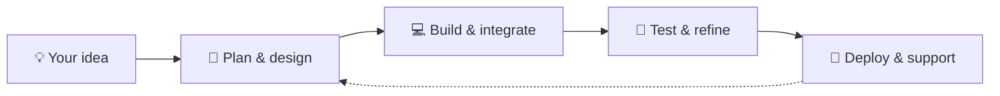

<div align="center">


### We don't just build websites. We build the systems behind them.

**Independent digital solutions studio · Helston, Cornwall, UK**

[](https://creatix.group)
[](https://creatix.group/services)
[](https://creatix.group)


</div>

---

## `> whoami`

We're **Creatix Group**, a Cornwall-based digital technology business bringing **software development, broadcast technology, infrastructure and automation** together under one roof.

From a website that looks the part to the servers, APIs and custom tooling that make everything work behind the scenes, we build around the people who actually use the technology.

```text
creatix@cloud:~$ cat mission.txt

> Build thoughtfully.
> Automate intelligently.
> Keep systems connected.
> Make complex technology feel simple.

[SYSTEM STATUS] Ideas welcome. Coffee recommended. ☕
```

## `// What we build`

| 🌐 Digital Experiences | 🤖 Smart Automation | 📻 Broadcast Technology |
| :--- | :--- | :--- |
| Websites, portals, dashboards, user systems and custom integrations. | Discord bots, REST APIs, webhooks, workflows and community tools. | Radio websites, staff systems, streaming integrations, imaging and remote broadcast tools. |

| ☁️ Cloud & Infrastructure | 🛠️ Technical Operations | 🔌 Connected Platforms |
| :--- | :--- | :--- |
| VPS administration, Linux, Windows, reverse proxies, SSL and service deployments. | Uptime monitoring, troubleshooting, network configuration and ongoing support. | Authentication, platform integrations, databases and connected services. |

---

## `// Selected work`

<details open>
<summary><b>📻 OME Radio</b> · Broadcast platform & digital infrastructure</summary>
<br>

**Keeping the music flowing, both on air and behind the scenes.**

Website development, hosting and streaming infrastructure, backed by **AzuraCast integrations, custom APIs, staff tools and ongoing technical support**. A connected digital environment built around the needs of an online radio station.

`Web Development` · `AzuraCast` · `API Integrations` · `Infrastructure` · `Staff Tools`

</details>

<details open>
<summary><b>🧡 Buddies for CALM × Hyperlites</b> · Charity gaming event platform</summary>
<br>

**Technology that helps a community come together for a cause.**

A bespoke digital home for a charity gaming tournament, with a **custom PHP website, Discord integration, team registrations, event information and tournament operations tooling**.

[**Explore the platform →**](https://buddies.hyperlites.co.uk/)

`PHP` · `Discord.js` · `Authentication` · `Registrations` · `Community Tools`

</details>

<details open>
<summary><b>🎧 Euphoria Media</b> · Web, bots & media infrastructure</summary>
<br>

**A joined-up digital platform for a media community.**

Bespoke website development, custom Discord bots, tailored API integrations and support for **networking, hosting and AzuraCast services**.

`Web Development` · `Discord Bots` · `AzuraCast` · `Hosting` · `APIs`

</details>

<details open>
<summary><b>☁️ Creatix Cloud</b> · Infrastructure & hosting environment</summary>
<br>

**The infrastructure behind our connected services.**

Our cloud environment for deploying and managing supported applications and services, incorporating **server administration, reverse proxy configuration, SSL, container-based workloads and uptime monitoring**.

`Ubuntu` · `Nginx` · `Docker` · `Pterodactyl` · `Monitoring`

</details>

<details open>
<summary><b>🎙️ StudioLINK Beta</b> · Outside broadcast connectivity</summary>
<br>

**Making remote and outside broadcasting easier to connect.**

A hosted solution built for outside broadcasts, featuring **integrated camera and audio feeds** for presenters and guests. Designed for community radio teams and tested with **BUTT, Myriad and PlayItLive**.

`Broadcast Technology` · `Audio` · `Video` · `Hosted Platform` · `Outside Broadcasts`

</details>

---

## `// Our toolbox`

<div align="center">

**Languages & frameworks**


**Infrastructure & platforms**


</div>

---

## `// How we work`



**No one-size-fits-all packages. No unnecessary complexity.** Just practical solutions, clear communication and a genuine interest in making things work well.

<details>
<summary><b>🔎 A little more about our approach</b></summary>
<br>

- **Built around the brief:** We scope the project to the people, goals and systems involved.
- **End-to-end thinking:** Frontend, backend, integrations and infrastructure belong in the same conversation.
- **Transparent communication:** We explain what we're building and why.
- **Support beyond launch:** Deployment isn't the end of a good project.

</details>

---

<div align="center">

### Have a project in mind?

**A new website? A custom bot? A radio platform? Something a little unusual?**

We'd love to hear what you're building.

[](https://creatix.group)
[](https://creatix.group/services)

<sub>Made with care in Cornwall, UK · © 2026 Creatix Group</sub>


</div>
